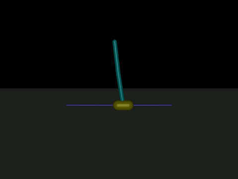

# Stage 1: Serial ES Balancing the Inverted Double Pendulum

IT 388 group project: Canyon Palmatier, Brady McCue, Marcos Villalobos



Trains a controller that balances a two-link inverted pendulum on a cart, using
Evolution Strategies (ES) in C, with MuJoCo for the physics. Runs on **one core**.
This is the baseline that Stage 2 parallelizes.

**Result:** reaches the target evaluation return of 9,000 (maximum about 9,350)
in 60 generations (about 23 s) with seed 1, 45 with seed 2 and 70 with seed 3.
On 100 random start states it never saw in training, the saved controller
balances the pendulum for all 1,000 steps in 96 (`scripts/evaluate.py`).

---

## Where the code comes from

Every file starts with a SOURCES block. Lines taken from another project are
marked `SOURCE [...]` (usually with the original line quoted), and our own code
is marked `OUR CODE`.

| Source | License | Used for | Where |
|---|---|---|---|
| **Gymnasium** InvertedDoublePendulum-v5 (Farama Foundation) | MIT | Model file (copied unchanged); observation, reward, termination, reset and frame skip, translated line by line from Python to C; also the reference that `check_env.py` compares against | `models/inverted_double_pendulum.xml`, `src/env.c`, `scripts/check_env.py` |
| **MuJoCo** C library and `sample/basic.cc` (Google DeepMind) | Apache 2.0 | Physics engine; load, make data, step, free pattern | `src/env.c` |
| **MuJoCo** Python docs (viewer, Renderer) | Apache 2.0 | Viewing and recording a controller | `scripts/replay.py` |
| **OpenAI evolution-strategies-starter** (`es.py`, `optimizers.py`, `policies.py`, `tf_util.py`) | MIT | Mirrored sampling, centered-rank fitness shaping, weighted-sum update, L2 coefficient, RunningStat input normalization, input clipping to ±5, tanh network, normc starting weights | `src/es.c`, `src/policy.c` |
| Salimans et al., ES paper (2017), Algorithm 1 | paper | The ES update (including dividing by σ) | `src/es.c` |
| Kingma & Ba, Adam (2015), Algorithm 1 | paper | Optimizer | `src/es.c` |
| Vigna, SplitMix64 | public domain | Random-number mixing function | `src/rng.h` |
| Salmon et al., "Parallel Random Numbers: As Easy as 1, 2, 3" (2011) | paper | Counter-based random numbers (compute any random number directly from a key) | `src/rng.h` |
| Box & Muller (1958) | paper | Uniform to normal random numbers | `src/rng.h` |
| Fowler, Noll, Vo, FNV-1a | public domain | Fingerprint ("theta hash") of the trained controller | `src/es.c` |

**Our code:** the C program structure, generalizing the environment to any
number of links, seeded random numbers (`rng_key`), evaluation on fixed start
states, the stop-at-target rule, logging and saving, the tanh on the network's
output, and all scripts except where marked.

**Our changes to sources:** OpenAI's ES code reads noise from a big shared
table, while we compute it from seeds. It collects input statistics from 1% of
episodes, while we use all. Its update does not divide by σ, but the paper's
Algorithm 1 does, and so do we. Its output layer is linear, while ours uses tanh.

---

## Files

```
src/
  env.c, env.h       C version of Gymnasium's InvertedDoublePendulum-v5
  policy.c, policy.h the controller: neural network with 32 hidden neurons, 353 parameters
  rng.h              seeded random numbers
  es.c               the ES trainer
  env_test.c         helper for check_env.py
models/
  inverted_double_pendulum.xml   Gymnasium's model file
  trained/double_mlp32.theta     a trained controller (seed 1)
scripts/
  get_mujoco.sh      downloads the MuJoCo C library
  check_env.py       compares our C environment with Gymnasium step by step
  evaluate.py        success rate on 100 random start states
  replay.py          watch a controller, or save a GIF
results/
  training_log.csv   per-generation log of the seed-1 run
  double.gif         the trained controller balancing for 30 s
```

---

## Build and run (Linux)

Needs `gcc` and `curl`. Python 3 with `pip install mujoco gymnasium numpy imageio`
is only needed for the scripts.

```bash
scripts/get_mujoco.sh     # downloads MuJoCo 3.3.7 into third_party/mujoco
make                      # builds bin/es_serial and bin/env_test
./bin/es_serial           # trains until the evaluation return reaches 9000
```

```
  gen   time(s)   pop mean    pop max       eval  avg len
  ...
   60     23.13     2630.0     9345.1     9324.6    283.2

Done: 60 generations in 23.13 s (target reached)
  final evaluation return  9324.6
```

- **pop mean / pop max:** average and best return of the 256 perturbed controllers tested this generation
- **eval:** return of the current controller, averaged over 8 fixed start states
- **avg len:** average episode length in steps (1,000 = never fell)

```bash
./bin/es_serial --save my.theta --log my_log.csv
python3 scripts/evaluate.py my.theta                              # success rate
python3 scripts/replay.py my.theta                                # viewer (needs a display)
MUJOCO_GL=egl python3 scripts/replay.py my.theta --gif my.gif     # no display needed
```

| Option | Default | Meaning |
|---|---|---|
| `--pairs N` | 128 | mirrored pairs per generation (population = 2N) |
| `--hidden N` | 32 | hidden neurons; `0` = linear controller |
| `--sigma X` | 0.1 | size of the random perturbations |
| `--lr X` | 0.05 | Adam learning rate |
| `--l2 X` | 0.005 | weight decay (OpenAI's `l2coeff`) |
| `--gens N` | 300 | maximum generations |
| `--seed N` | 1 | random seed |
| `--target X` | 9000 | stop at this evaluation return (`0` = run all generations) |
| `--eval-every N` / `--eval-eps N` | 5 / 8 | how often, and on how many start states, to test |
| `--log FILE` / `--save FILE` | | per-generation CSV / save the controller |

---

## How it works

**Environment (`src/env.c`).** Every step the controller sees 9 numbers (cart
position, sine and cosine of both hinge angles, three velocities, and the cart's
constraint force) and outputs a push in [−1, 1]. Reward per step, from Gymnasium:
`10 − 0.01·x_tip² − (y_tip − 2)² − (0.001·ω₁² + 0.005·ω₂²)`. The episode ends when
the tip drops to 1.0 m or after 1,000 steps. One step is 5 MuJoCo steps (0.05 s).

**Controller (`src/policy.c`).** `action = tanh(w2 · tanh(W1·x + b1) + b2)`, where
`x` is the normalized observation. All the weights and biases together are θ
(353 numbers).

**Training (`src/es.c`), one generation:**

1. Make 128 random perturbations ε of θ.
2. Test each twice, as θ + σε and θ − σε, from the same start state.
3. Rank all 256 returns, and move θ toward perturbations that ranked well and
   away from those that ranked badly, using Adam.
4. Every 5 generations, test θ itself on 8 fixed start states.

**Input normalization** (OpenAI's RunningStat): each input is rescaled by the
running mean and standard deviation of every state seen so far, then clipped
to ±5. Without normalization the network barely learned.

---

## Checking correctness

```bash
make check
```

Runs 20 episodes with the same start states and actions through our C
environment and through Gymnasium itself: largest reward difference 1.8e-15
(rounding), observations identical.

The printed "theta hash" fingerprints the trained controller. It is the same on
every run with the same settings and MuJoCo version. A different MuJoCo version
rounds slightly differently and gives a different but equally good controller.

---

## References

1. Farama Foundation, Gymnasium, "Inverted Double Pendulum."
   https://gymnasium.farama.org/environments/mujoco/inverted_double_pendulum/ ;
   source https://github.com/Farama-Foundation/Gymnasium
2. E. Todorov, T. Erez, Y. Tassa, "MuJoCo: A physics engine for model-based control,"
   IROS 2012. Code and samples: https://github.com/google-deepmind/mujoco
3. T. Salimans, J. Ho, X. Chen, S. Sidor, I. Sutskever, "Evolution Strategies as a
   Scalable Alternative to Reinforcement Learning," arXiv:1703.03864, 2017.
4. OpenAI, evolution-strategies-starter. https://github.com/openai/evolution-strategies-starter
5. D. P. Kingma, J. Ba, "Adam: A Method for Stochastic Optimization," ICLR 2015.
6. S. Vigna, SplitMix64. https://prng.di.unimi.it/splitmix64.c
7. J. Salmon, M. Moraes, R. Dror, D. Shaw, "Parallel Random Numbers: As Easy as 1, 2, 3," SC '11, 2011.
8. G. E. P. Box, M. E. Muller, "A Note on the Generation of Random Normal Deviates,"
   Annals of Mathematical Statistics 29(2), 1958.
9. G. Fowler, L. C. Noll, K.-P. Vo, FNV hash. http://www.isthe.com/chongo/tech/comp/fnv/
