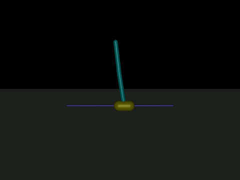
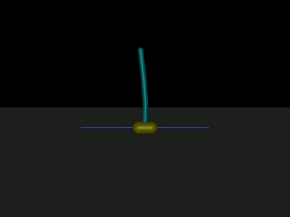

# Stage 3: The Triple Pendulum

IT 388 group project: Canyon Palmatier, Brady McCue, Marcos Villalobos

| Double pendulum (Stage 1-2) | Triple pendulum (new) |
|---|---|
|  |  |

Stage 2 plus a **three-link pendulum**. The same MPI trainer runs it; only the
model file and a few lines of the environment change.

**What is new in Stage 3:**

- `models/inverted_triple_pendulum.xml`: Gymnasium's double pendulum with a third pole added the way DeepMind's Control Suite builds its multi-pole cartpoles
- `src/env.c`: reads the start-state noise from the model file; a third hinge in the velocity penalty
- `scripts/lqr_baseline.py`: classical LQR controller as a reference, following MuJoCo's LQR tutorial
- `scripts/replay.py`, `scripts/evaluate.py`: use each model's start noise
- `scripts/verify_identical.sh`: also checks the triple pendulum
- `models/trained/triple_linear.theta`, `results/triple.gif`

**Results (2-core test machine, 2 MPI processes):**

| Controller on the triple pendulum | Parameters | Generations to target | Time |
|---|---|---|---|
| Linear, σ = 0.05 | 13 | **140** | 32 s |
| 8 hidden neurons, σ = 0.05, 256 pairs | 113 | 250 | 100 s |
| 32 hidden neurons, σ = 0.05 | 449 | not reached in 600 (return ~310) | |

The saved linear controller balances **92 of 100** unseen start states for all
1,000 steps (`scripts/evaluate.py`). The LQR controller, which knows the physics,
balances 19 of 20. So random search with few parameters comes close to the
optimal linear controller. More parameters make the search much harder, which
matches Mania et al. [13]: simple linear controllers are very competitive on
these tasks.

### Design decisions for the triple pendulum

**Pole length.** Gymnasium's poles are 0.6 m. We made each of the three 0.4 m,
so the upright tip is at 1.2 m, the same as the double pendulum. That keeps the
reward (`(y − 2)²`) and the termination rule (tip height ≤ 1 m) unchanged.

**Start-state noise 0.05 instead of 0.1.** With Gymnasium's 0.1 rad random
offsets on all three hinges, many episodes start already lost:

| Model | Start noise | LQR episodes balanced (of 20) |
|---|---|---|
| Double | 0.1 | 20 |
| Triple | 0.1 | 6 |
| Triple | 0.05 | 19 |

The model stores this as `<numeric name="reset_noise_scale" data="0.05"/>`. That
is the same mechanism Gymnasium's file uses for `frame_skip`, and `src/env.c`
reads it.

**Why LQR is computed by hand.** MuJoCo's LQR tutorial linearizes with
`mjd_transitionFD`, but that function does not support the RK4 integrator these
models use. `lqr_baseline.py` does the same finite-difference linearization
itself, then uses the tutorial's Riccati solve and gain formula.

---

## Where the code comes from

Every file starts with a SOURCES block. Lines taken from another project are
marked `SOURCE [...]` (usually with the original line quoted), and our own code
is marked `OUR CODE`.

| Source | License | Used for | Where |
|---|---|---|---|
| **Gymnasium** InvertedDoublePendulum-v5 (Farama Foundation) | MIT | Model file (copied unchanged); observation, reward, termination, reset and frame skip, translated line by line from Python to C; also the reference that `check_env.py` compares against | `models/inverted_double_pendulum.xml`, `src/env.c`, `scripts/check_env.py` |
| **MuJoCo** C library and `sample/basic.cc` (Google DeepMind) | Apache 2.0 | Physics engine; load, make data, step, free pattern | `src/env.c` |
| **MuJoCo** Python docs (viewer, Renderer) | Apache 2.0 | Viewing and recording a controller | `scripts/replay.py` |
| **OpenAI evolution-strategies-starter** (`es.py`, `optimizers.py`, `policies.py`, `tf_util.py`) | MIT | Mirrored sampling, centered-rank fitness shaping, weighted-sum update, L2 coefficient, RunningStat input normalization, input clipping to ±5, tanh network, normc starting weights | `src/es.c`, `src/policy.c` |
| Salimans et al., ES paper (2017), Algorithm 1 | paper | The ES update (including dividing by σ) | `src/es.c` |
| Kingma & Ba, Adam (2015), Algorithm 1 | paper | Optimizer | `src/es.c` |
| Vigna, SplitMix64 | public domain | Random-number mixing function | `src/rng.h` |
| Salmon et al., "Parallel Random Numbers: As Easy as 1, 2, 3" (2011) | paper | Counter-based random numbers (compute any random number directly from a key) | `src/rng.h` |
| Box & Muller (1958) | paper | Uniform to normal random numbers | `src/rng.h` |
| Fowler, Noll, Vo, FNV-1a | public domain | Fingerprint ("theta hash") of the trained controller | `src/es.c` |
| Salimans et al., ES paper (2017), **Algorithm 2** | paper | Parallel design: shared random seeds, workers exchange only scalar returns, every worker rebuilds the perturbations and computes the same update | `src/es.c` |
| MPI Forum, MPI Standard 4.0 | standard | `MPI_Init`, `MPI_Comm_rank/size`, `MPI_Allgatherv`, `MPI_Allreduce`, `MPI_Wtime`, `MPI_Abort`, `MPI_Finalize` | `src/es.c` |
| Pacheco, *An Introduction to Parallel Programming* (2011), Ch. 2.6 and 3 | book | MPI program structure, collective communication, timing; speedup and efficiency definitions | `src/es.c`, `scripts/speedup.sh` |
| Quinn, *Parallel Programming in C with MPI and OpenMP* (2004) | book | `BLOCK_LOW` / `BLOCK_HIGH` block decomposition of the pairs | `src/es.c` |
| Open MPI `mpirun` | BSD | Launching MPI programs | `scripts/*.sh` |
| **DeepMind Control Suite** `cartpole.py` `_make_model(n_poles)` | Apache 2.0 | How to add poles: nest each new pole body in the previous one at its tip, with its own hinge and geom (as in its `three_poles` task) | `models/inverted_triple_pendulum.xml` |
| MuJoCo XML reference, `<custom><numeric>` | Apache 2.0 | Storing the start noise in the model; read with `mj_name2id(..., mjOBJ_NUMERIC, ...)` | model, `src/env.c` |
| **MuJoCo LQR tutorial** (`python/LQR.ipynb`) | Apache 2.0 | `solve_discrete_are` and the gain `K = (R + BᵀPB)⁻¹ BᵀPA` | `scripts/lqr_baseline.py` |
| Mania, Guy, Recht, ARS (2018) | paper | Evidence that linear controllers are competitive; our linear controller for the triple | discussion, `--hidden 0` |

**Our code:** packing each pair's results into one message, unpacking in pair
order so every process gets bit-identical sums, splitting the evaluation
episodes, the timing summary, the C program structure, generalizing the environment to any
number of links, seeded random numbers (`rng_key`), evaluation on fixed start
states, the stop-at-target rule, logging and saving, the tanh on the network's
output, and all scripts except where marked.

**Our changes to sources:** OpenAI's ES code reads noise from a big shared
table, while we compute it from seeds. It collects input statistics from 1% of
episodes, while we use all. Its update does not divide by σ, but the paper's
Algorithm 1 does, and so do we. Its output layer is linear, while ours uses tanh.

---

## Files

```
src/
  env.c, env.h       C version of Gymnasium's InvertedDoublePendulum-v5
  policy.c, policy.h the controller: neural network with 32 hidden neurons, 353 parameters
  rng.h              seeded random numbers
  es.c               the ES trainer (serial, or MPI with -DUSE_MPI)
  env_test.c         helper for check_env.py
models/
  inverted_double_pendulum.xml   Gymnasium's model file
  inverted_triple_pendulum.xml   our triple version (see its header)
  trained/triple_linear.theta    a trained triple controller (linear, 13 parameters)
  trained/double_mlp32.theta     a trained controller (seed 1)
scripts/
  get_mujoco.sh      downloads the MuJoCo C library
  check_env.py       compares our C environment with Gymnasium step by step
  evaluate.py        success rate on 100 random start states
  lqr_baseline.py    LQR reference controller (is a model balanceable?)
  replay.py          watch a controller, or save a GIF
  verify_identical.sh  serial and 1, 2, 3, 5 MPI processes must train the same controller
  speedup.sh           time to target, serial vs 1, 2, 4... processes
results/
  training_log.csv   per-generation log of the seed-1 run
  double.gif, triple.gif  the trained controllers balancing for 30 s
```

---

## Build and run (Linux)

Needs `gcc`, `curl` and Open MPI (`sudo apt install libopenmpi-dev openmpi-bin`).
Python 3 with `pip install mujoco gymnasium numpy imageio`
is only needed for the scripts.

```bash
scripts/get_mujoco.sh     # downloads MuJoCo 3.3.7 into third_party/mujoco
make                      # builds bin/es_serial, bin/es_mpi and bin/env_test
./bin/es_serial           # trains until the evaluation return reaches 9000
mpirun -np 4 ./bin/es_mpi # same training, 4 processes
make verify               # every process count gives the same controller
scripts/speedup.sh        # speedup on this computer

# Triple pendulum: linear controller, smaller perturbations
mpirun -np 4 ./bin/es_mpi --model models/inverted_triple_pendulum.xml --hidden 0 --sigma 0.05
python3 scripts/evaluate.py models/trained/triple_linear.theta --model models/inverted_triple_pendulum.xml
python3 scripts/lqr_baseline.py models/inverted_triple_pendulum.xml --noise 0.1
```

The MPI version adds a timing summary:

```
Done: 60 generations in 11.12 s with 2 process(es) (target reached)
  rollout time             ... s average per process, ... s slowest process
  communication + waiting  ... s average per process
```

"Communication + waiting" includes time a fast process spends waiting at
`MPI_Allgatherv` for the slowest one, so it grows when the work is uneven.

```
  gen   time(s)   pop mean    pop max       eval  avg len
  ...
   60     23.13     2630.0     9345.1     9324.6    283.2

Done: 60 generations in 23.13 s (target reached)
  final evaluation return  9324.6
```

- **pop mean / pop max:** average and best return of the 256 perturbed controllers tested this generation
- **eval:** return of the current controller, averaged over 8 fixed start states
- **avg len:** average episode length in steps (1,000 = never fell)

```bash
./bin/es_serial --save my.theta --log my_log.csv
python3 scripts/evaluate.py my.theta                              # success rate
python3 scripts/replay.py my.theta                                # viewer (needs a display)
MUJOCO_GL=egl python3 scripts/replay.py my.theta --gif my.gif     # no display needed
```

| Option | Default | Meaning |
|---|---|---|
| `--pairs N` | 128 | mirrored pairs per generation (population = 2N) |
| `--hidden N` | 32 | hidden neurons; `0` = linear controller |
| `--sigma X` | 0.1 | size of the random perturbations |
| `--lr X` | 0.05 | Adam learning rate |
| `--l2 X` | 0.005 | weight decay (OpenAI's `l2coeff`) |
| `--gens N` | 300 | maximum generations |
| `--seed N` | 1 | random seed |
| `--target X` | 9000 | stop at this evaluation return (`0` = run all generations) |
| `--eval-every N` / `--eval-eps N` | 5 / 8 | how often, and on how many start states, to test |
| `--log FILE` / `--save FILE` | | per-generation CSV (with rollout and communication time) / save the controller |
| `--quiet` | | print only the summary |

---

## How it works

**Environment (`src/env.c`).** Every step the controller sees 9 numbers (cart
position, sine and cosine of both hinge angles, three velocities, and the cart's
constraint force) and outputs a push in [−1, 1]. Reward per step, from Gymnasium:
`10 − 0.01·x_tip² − (y_tip − 2)² − (0.001·ω₁² + 0.005·ω₂²)`. The episode ends when
the tip drops to 1.0 m or after 1,000 steps. One step is 5 MuJoCo steps (0.05 s).

**Controller (`src/policy.c`).** `action = tanh(w2 · tanh(W1·x + b1) + b2)`, where
`x` is the normalized observation. All the weights and biases together are θ
(353 numbers).

**Training (`src/es.c`), one generation:**

1. Make 128 random perturbations ε of θ.
2. Test each twice, as θ + σε and θ − σε, from the same start state.
3. Rank all 256 returns, and move θ toward perturbations that ranked well and
   away from those that ranked badly, using Adam.
4. Every 5 generations, test θ itself on 8 fixed start states.

**Parallel version (Salimans et al., Algorithm 2).** Each process tests only its
block of pairs (`BLOCK_LOW`..`BLOCK_HIGH`). One `MPI_Allgatherv` then gives
every process, for every pair, the two returns, the two episode lengths and the
input statistics (4 + 2×9 = 22 numbers per pair, about 22 KB per generation).
Because every process knows every seed, it rebuilds all 128 perturbations
itself and computes the same update, so the 353 parameters are never sent.

```
for each generation:
    my pairs = BLOCK_LOW(rank) .. BLOCK_HIGH(rank)
    for p in my pairs:
        eps_p = noise(seed, generation, p)            # rebuilt from the shared seed
        score+, score- = episode(theta + sigma*eps_p), episode(theta - sigma*eps_p)
    MPI_Allgatherv(scores of my pairs)                # only scores travel
    every process: rank all scores, rebuild every eps_p, same Adam step on theta
```

**Input normalization** (OpenAI's RunningStat): each input is rescaled by the
running mean and standard deviation of every state seen so far, then clipped
to ±5. Without normalization the network barely learned.

---

## Checking correctness

```bash
make check     # our environment vs Gymnasium
make verify    # serial vs 1, 2, 3, 5 MPI processes, and serial vs 3 on the triple
```

`make verify` result: every run prints the same theta hash. Processes never
disagree about θ, even though θ is never sent.


Runs 20 episodes with the same start states and actions through our C
environment and through Gymnasium itself: largest reward difference 1.8e-15
(rounding), observations identical.

The printed "theta hash" fingerprints the trained controller. It is the same on
every run with the same settings and MuJoCo version. A different MuJoCo version
rounds slightly differently and gives a different but equally good controller.

---

## References

1. Farama Foundation, Gymnasium, "Inverted Double Pendulum."
   https://gymnasium.farama.org/environments/mujoco/inverted_double_pendulum/ ;
   source https://github.com/Farama-Foundation/Gymnasium
2. E. Todorov, T. Erez, Y. Tassa, "MuJoCo: A physics engine for model-based control,"
   IROS 2012. Code and samples: https://github.com/google-deepmind/mujoco
3. T. Salimans, J. Ho, X. Chen, S. Sidor, I. Sutskever, "Evolution Strategies as a
   Scalable Alternative to Reinforcement Learning," arXiv:1703.03864, 2017.
4. OpenAI, evolution-strategies-starter. https://github.com/openai/evolution-strategies-starter
5. D. P. Kingma, J. Ba, "Adam: A Method for Stochastic Optimization," ICLR 2015.
6. S. Vigna, SplitMix64. https://prng.di.unimi.it/splitmix64.c
7. J. Salmon, M. Moraes, R. Dror, D. Shaw, "Parallel Random Numbers: As Easy as 1, 2, 3," SC '11, 2011.
8. G. E. P. Box, M. E. Muller, "A Note on the Generation of Random Normal Deviates,"
   Annals of Mathematical Statistics 29(2), 1958.
9. G. Fowler, L. C. Noll, K.-P. Vo, FNV hash. http://www.isthe.com/chongo/tech/comp/fnv/
10. MPI Forum, "MPI: A Message-Passing Interface Standard," Version 4.0, 2021. https://www.mpi-forum.org/docs/
11. P. Pacheco, *An Introduction to Parallel Programming*, Morgan Kaufmann, 2011.
12. M. J. Quinn, *Parallel Programming in C with MPI and OpenMP*, McGraw-Hill, 2004.
13. H. Mania, A. Guy, B. Recht, "Simple random search of static linear policies is
    competitive for reinforcement learning," NeurIPS 2018.
14. Y. Tassa et al., "DeepMind Control Suite," arXiv:1801.00690, 2018. Code:
    https://github.com/google-deepmind/dm_control (suite/cartpole.py)
15. Google DeepMind, MuJoCo LQR tutorial, https://github.com/google-deepmind/mujoco/blob/main/python/LQR.ipynb
